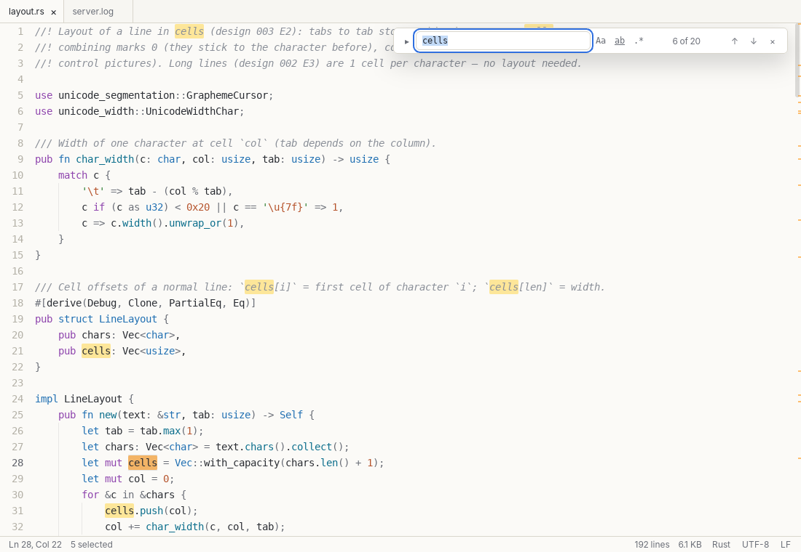

<p align="center"></p>

<h1 align="center">editlicious</h1>

<p align="center"><b>A calm, keyboard-first text editor for huge files.</b><br>
Millions of lines. Lines with millions of characters. Almost no chrome.</p>

---

editlicious is the reboot of a Java/Swing editor from 2012 as a modern desktop app for **macOS, Windows and Linux**,
built with [Tauri 2](https://tauri.app), Angular 22 (zoneless, signals) and Rust – and, with the same engine, a
**web component** for your own pages ([npm: `editlicious-editor`](https://www.npmjs.com/package/editlicious-editor)).

**[Download](https://github.com/krocon/editlicious/releases/latest)** ·
[Product page](https://krocon.de/products/editlicious/) ·
[Live demo](https://krocon.de/products/editlicious/demo/)

- **Huge files first** – the text lives in a rope in the Rust backend; the window only ever renders what you see,
  vertically *and* horizontally.
- **Distraction-free** – menu, tabs and status bar hide away; everything is reachable by shortcut and command palette.
- **Your encodings, your line endings** – detected on load, kept on save; saving is atomic.
- **Find and replace** with regular expressions, a mark for every match beside the scroll bar, go to line.
- **Several carets and column selection**, sort lines, change case, move, duplicate and join lines, toggle line comments.
- **Syntax colours** for more than 70 languages and **thirteen colour schemes** from light to dark.
- **Selections that grow** with every double click – word, `snake_case` part, path segment, brackets, line,
  paragraph ([`docs/selection.md`](docs/selection.md)).
- **Word completion** (Ctrl+Space) from the words around the cursor and typical words of the language –
  Java with Spring Boot, Kotlin, TypeScript with Angular, Python, SQL and more, plus your own lists
  ([`docs/completion.md`](docs/completion.md)).
- **Ten word markers** that jump (F7), count and stay in “Copy as HTML” – solid colours for e-mail.
- **Colour values as swatches** in the gutter (`#hex`, `rgb()`, `hsl()`, `0xAARRGGBB`, `"ffRRGGBB"`), converted
  with one action.
- **Arithmetic where you type** – `255/8=` shows and inserts `31.875`.
- **Record and play back** – macros, and typing scripts with a human rhythm, rendered straight to video at any
  size (`editlicious render`, [`docs/scripts.md`](docs/scripts.md)).
- **AI control (MCP)** – opt-in: Claude Code and other assistants can open, read, type and record
  ([`docs/mcp.md`](docs/mcp.md)).

> Current release: **1.2.0** – [release notes](https://github.com/krocon/editlicious/releases). How it was built,
> prompt by prompt: [`prompts/README.md`](prompts/README.md).



## Download

Packages are on the [releases page](https://github.com/krocon/editlicious/releases/latest), with `SHA256SUMS.txt`:

| OS | Package | Note |
|---|---|---|
| macOS 12+ | `.dmg` (Apple silicon and Intel) | not code-signed yet: the first time, right-click the app → Open |
| Windows 10/11 | setup `.exe`, `.msi` | not code-signed yet: SmartScreen → More info → Run anyway |
| Linux | `.deb`, `.rpm`, `.AppImage` | |

No telemetry, no account, no update pings.

## Website and live demo

`site/` holds the promotional page (one static HTML file, no JavaScript) and `site/demo/`, a live demo that runs the
real editing engine (`ed-core`) in the browser as WebAssembly. See [`site/README.md`](site/README.md);
`pnpm site:demo` rebuilds the engine, `pnpm site:test` checks the page.

## Embedding the editor in a web page

The same editor view and engine (as WebAssembly in a worker) also come as a standalone component – from npm
(`npm install editlicious-editor`) or straight from a CDN:

```html
<script type="module" src="https://cdn.jsdelivr.net/npm/editlicious-editor/editlicious-editor.js"></script>
<editlicious-editor language="Rust" scheme="one" word-wrap status-bar></editlicious-editor>
```

Attributes / properties: `value`, `language` (grammar, `TypeScript`, or a file name like `app.ts`), `scheme`
(`auto`, one of the 13 schemes, or `none` – only the page's own colours, with `color-scheme`), `readonly`,
`word-wrap`, `line-numbers`, `status-bar`, `tab-width`, `insert-spaces`, `font-size`, `font-family`,
`indent-guides`, `color-swatches`, `overview`, `math-hints`, `word-suggest`, `completion-sources`, `ui-language`;
properties only: `completionProvider`, `snippets`. Events `ed-change` (revision, dirty, line and character count –
never the text), `ed-caret`, `ed-ready`, `ed-marker-click`; methods `getValue()`, `getSlice()`, `setValue()`,
`loadText()`, `focus()`, `runCommand()`, `runAction()`, `find()`, `goTo()`, `playScript()`.

Since 1.2 a page can extend the editor without the editor knowing its language – everything optional:

- **Colours:** every colour is a documented CSS variable on the element (`--ed-*`, `--syn-*`, `--color-*`).
- **Selections and ranges:** `getSelection()`, `getSelections()`, `getRange()`, `replaceRange()`,
  `replaceSelection()`.
- **Suggestions:** `completionProvider` – the page's entries in the editor's suggestion list.
- **Markers:** `setMarkers(owner, …)`, `clearMarkers()`, `getMarkers()` – underlines, gutter symbols and hints
  that follow the text.
- **Snippets:** `insertSnippet()` and `snippets` – placeholders, Tab from stop to stop.

In Angular: `<ed-editor [value]="…" language="TypeScript" [readOnly]="true" />`
(`src/app/embed/editlicious-editor.ts`). Build with `pnpm build:element` (→ `dist/element/editlicious-editor/`, the
npm package `editlicious-editor` – see [its README](packages/editlicious-editor/README.md) for the full reference);
`site/embed/` shows three editors side by side.

## Development

```bash
pnpm install
pnpm tauri dev      # app with hot reload (Angular on port 1440)
pnpm check          # format, lint, tests, build, cargo fmt/clippy/test
```

Requirements: Node ≥ 22.22.3, pnpm 10, Rust stable ≥ 1.93 and the
[Tauri prerequisites](https://tauri.app/start/prerequisites/) of your OS.

## Release

Packages for macOS, Windows and Linux are built by the *Release* workflow (tag `v*`) as a draft release –
see [`docs/release.md`](docs/release.md). The npm package is the folder `dist/element/editlicious-editor/` after
`pnpm build:element`. Third-party licences: [`THIRD-PARTY-NOTICES.txt`](THIRD-PARTY-NOTICES.txt).

## License

MIT © 2026 Marc Kronberg. The wordmark uses outlines of *Yellowtail* by Astigmatic (Apache License 2.0, see THIRD-PARTY-NOTICES.txt).
