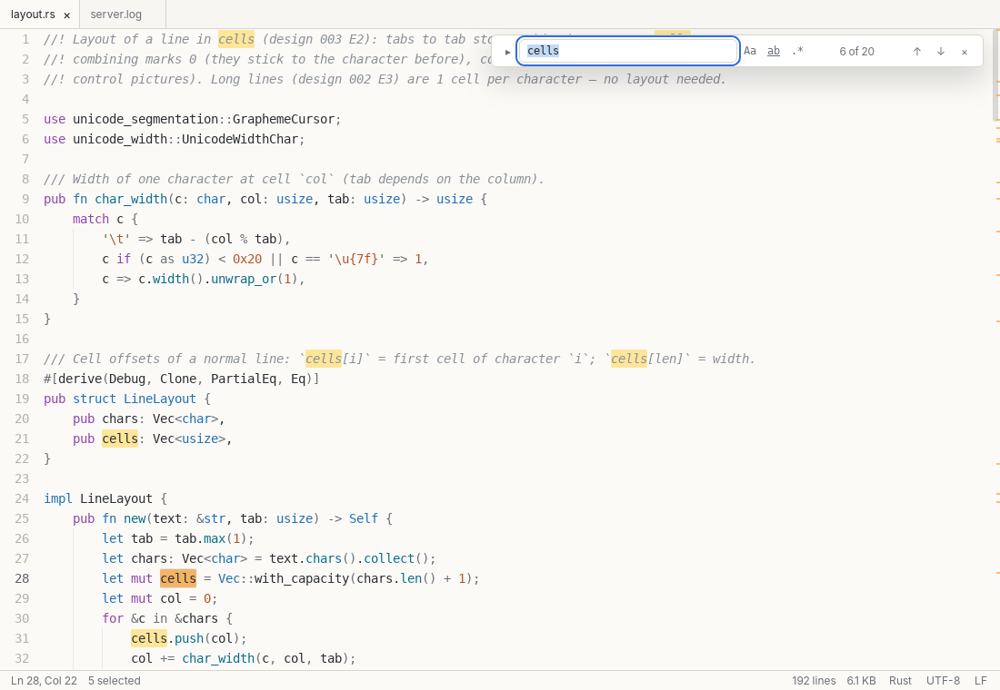

<p align="center"></p>

<h1 align="center">editlicious</h1>

<p align="center"><b>A calm, keyboard-first text editor for huge files.</b><br>
Millions of lines. Lines with millions of characters. Almost no chrome.</p>

---

editlicious is the reboot of a Java/Swing editor from 2012 as a modern desktop app for **macOS, Windows and Linux**,
built with [Tauri 2](https://tauri.app), Angular 22 (zoneless, signals) and Rust.

- **Huge files first** – the text lives in a rope in the Rust backend; the window only ever renders what you see,
  vertically *and* horizontally.
- **Distraction-free** – menu, tabs and status bar hide away; everything is reachable by shortcut and command palette.
- **Your encodings, your line endings** – detected on load, kept on save.
- **Record and play back** – macros, and typing scripts for screen videos with a human rhythm
  ([`docs/scripts.md`](docs/scripts.md)).

> Status: in development. Progress and plan: [`prompts/README.md`](prompts/README.md).



## Website and live demo

`site/` holds the promotional page (one static HTML file, no JavaScript) and `site/demo/`, a live demo that runs the
real editing engine (`ed-core`) in the browser as WebAssembly. See [`site/README.md`](site/README.md);
`pnpm site:demo` rebuilds the engine, `pnpm site:test` checks the page.

## Development

```bash
pnpm install
pnpm tauri dev      # app with hot reload (Angular on port 1440)
pnpm check          # format, lint, tests, build, cargo fmt/clippy/test
```

Requirements: Node ≥ 22.22.3, pnpm 10, Rust stable ≥ 1.93 and the
[Tauri prerequisites](https://tauri.app/start/prerequisites/) of your OS.

## Release

Packages for macOS, Windows and Linux are built by the *Release* workflow (tag `v*`) as a draft release –
see [`docs/release.md`](docs/release.md). Third-party licences: [`THIRD-PARTY-NOTICES.txt`](THIRD-PARTY-NOTICES.txt).

## License

MIT © 2026 Marc Kronberg. The wordmark uses outlines of *Yellowtail* by Astigmatic (Apache License 2.0, see THIRD-PARTY-NOTICES.txt).
